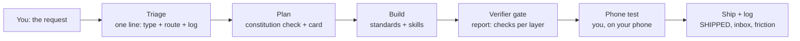
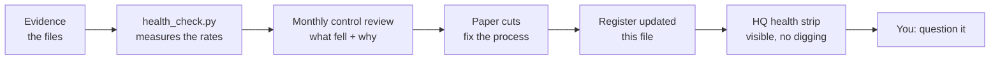

# Studio capabilities — the process-health register

> **Purpose:** OPERATE — the list of what the studio promises to do, the proof each promise must leave, and how the monthly check measures whether the proof is there.
> **Earns its place if:** a new capability enters with its evidence rule, and a monthly check proves the process is still followed — without the founder having to go looking.
> **Owner:** Bramble. **Status:** living.
> **Last verified:** 2026-11-15, against the second `health_check.py` run with H8 (see `health-reviews/2026-11.md`).

Published copy: https://github.com/nachiketmparanjape/one-man-studio/blob/main/CAPABILITIES.md — kept diff-zero with this file; the Mermaid diagrams render natively on GitHub.

## What this is, in plain words

The studio is a set of promises. Every request gets triaged. Every cut gets
checked before it reaches your phone. Your phone test is what "verified"
means. Everything shipped gets written down. Promises rot silently — nobody
announces that they stopped happening. This file lists the promises, what
proof each one must leave behind, and how a script measures whether the proof
is there. The monthly check does the measuring. You only see the exceptions.

The idea comes from Six Sigma, cut down to one-person size. Six Sigma's
loop is Define–Measure–Analyze–Improve–Control. Here that means: write down
what the process is supposed to do (this file), measure whether it happened
(the script), look at what fell and why (the monthly review), fix the process
with a paper cut (not a lecture), and keep the measurement running so drift
gets caught next month instead of next year. No belts, no statistics theatre.
The only number is a compliance rate: out of the things that should have left
proof, how many did?

## How a cut moves (the build loop)

Every box leaves proof in a file. The gate's proof is the cut report naming
what was checked per layer and what still needs your phone. The phone test's
proof is the SHIPPED.md entry saying "verified on the founder's phone". If
a box leaves no proof, the next box still runs — that is exactly how
structure degrades without anyone noticing.

## How we know it's still working (the control loop)

The loop closes on you, not on the script. The script can only measure what
the files show. You are the only check that can ask "is this measuring the
real thing, or a proxy that lies?" That question is part of the system — see
"How to question this" below.

## The capabilities

A capability is a promise plus its proof. "Measured" says how the monthly
check verifies it: AUTO means the script counts it from the files; SAMPLE
means the monthly review reads a few recent examples by hand (the agent's
hands, not yours). A proxy is labelled as one: it measures the trace a step
leaves, not the step itself.

| Capability | Promise | Proof it must leave (CTQ) | Measured |
|---|---|---|---|
| Triage | Every actionable request gets a one-line classification, route, and log destination | The triage line in chat + the entry in the right log | SAMPLE — review reads 5 recent requests |
| Planning walk | The full inventory is walked before any slate decision | PLAN.md notes the backlog, inbox, and issues walked | SAMPLE — read the last PLAN.md |
| Constitution check | Every card is checked against the product's VISION non-goals | PLAN.md notes the check | SAMPLE |
| Verifier gate | The cut's report names the checks per layer and what still needs the phone | SHIPPED entry carries verification language | AUTO (proxy) — check H2 |
| Phone test | Nothing is called verified until your phone did it | SHIPPED entry says phone-verified | AUTO — check H3 |
| Standards read | The cut cites the standards it followed | Cut record names a standard | AUTO (proxy) — check H5 |
| Skills used | A skill is invoked when the work matches it | Cut record or report names the skill | AUTO (proxy) — check H5 |
| Doc review | Monthly on the 5th: sync, staleness, purpose drift, key docs, reaper verdicts | `doc-reviews/YYYY-MM.md` exists | AUTO — check H6 |
| Curator | Monthly on the 22nd: backlog hygiene, cost audit, competitor watch | Inbox curator entry exists that month | AUTO — check H6 |
| Tool scout | Monthly on the 15th: finds with verdicts, sheet rows | Inbox scout entry + Tool Library rows | AUTO — check H6 |
| Mirror sync | GitHub Issues match the docs | A mirror run with no drift, or drift recorded | SAMPLE — run mirror, report drift |
| Inbox | Ideas parked with revisit triggers; decisions recorded | Inbox entries carry a status line (LOGS.md) | AUTO — check H8 |
| Friction log | Complaints become paper cuts | friction.md entries carry a status line (LOGS.md) | AUTO — checks H7 + H8 |
| SHIPPED currency | Every shipped cut is recorded | SHIPPED entries match sprint PLAN DONE cards | AUTO — check H1 |
| Tool Library truth | Sheet verdicts match the inbox verdicts | Sheet row verdict = latest inbox verdict | AUTO — check H4 |
| Log hygiene | Every log entry carries a status, owner, priority, and next action; finished entries leave the live file in 30 days | Status lines in inbox.md + friction.md; archive files grow by finished entries | AUTO — check H8 |

### Trial capabilities (the November pilots)

| Capability | Promise | Proof / graduation bar | Status |
|---|---|---|---|
| Context7 docs | Library APIs resolved against current docs before writing code | A cut report cites Context7 as its docs source; graduates to Active after 3 such cuts | Trial — skill written 2026-11-15, first use at the next coding cut |
| CodeRabbit review | Every PR gets a second reviewer; its comments get triaged | Its comments triaged on 3 PRs with a signal/noise verdict at a planning walk; graduates to Active on a keep verdict | Trial — installed 2026-11-15 on the-closet only |
| chrome-devtools-mcp | A real browser verifies the live site before your phone | Pilot NO-GO 2026-11-15: the Hatch Chromium build cannot be launched from the shell (WebGL domain policy). Parked, not skipped — retry if the runtime exposes a CDP endpoint or launchable Chrome | Parked |

## Lifecycle

| Stage | Meaning | What proves the move |
|---|---|---|
| Trial | A pilot, with a verdict date | The pilot runs and a verdict is recorded |
| Active | In use, measured monthly | The evidence bar in the table above is met |
| Embedded | Used across two or more products | Evidence shows use in a second product |
| Retired / Parked | Stopped, with the reason recorded | The reason lands in all three homes at once — inbox, Tool Library sheet, this register |

The three-homes rule is the debt-ops lesson: a tool killed in the inbox but
still reading "Try" in the sheet a month later is the failure this register
exists to prevent. A retirement that is not in all three homes did not happen.

## Thresholds

- **90% compliance per automated check.** Below 90% in a month, the review
  names the failing items and why.
- **Two consecutive months below 90%** on the same check means corrective
  action: a paper cut filed to fix the process (or the check, if the check
  is the thing that is wrong).
- Sampled checks are judged pass/fail by the monthly review, with the reason
  written down. A sampled check that fails twice gets the same treatment.

## How to question this (for the founder)

You do not need to read the script. Three questions, once a month, when the
health report lands:

1. **Which capability is red, and what exactly did the check look at?**
   The report names the failing items. If it cannot name them, the check is
   not measuring anything real — say so.
2. **Is the check measuring the real thing, or a proxy — and is the proxy
   lying?** Anything marked "proxy" above measures the trace a step leaves,
   not the step. If a step is happening but leaving no trace, the fix is to
   record it, not to pretend the check is wrong. If the trace exists but the
   step did not happen, the check is lying and the check gets fixed.
3. **What changed since last month — better, worse, or the same?** A rate
   that falls two months running is the signal. A rate that is flat at 100%
   on a proxy is suspicious, not reassuring — ask what the proxy cannot see.

And the standing rule behind all three: **if a capability has no proof, it
does not exist yet.** Ask to see the evidence, not the claim. That is the
job this register gives you — and the reason the diagram above puts you at
the end of the loop, not outside it.

## The checks (what `health_check.py` runs)

- **H1 — Cut has a card.** Recent SHIPPED entries name a card ID that exists
  in a sprint PLAN.md / SPRINT.md or BACKLOG.md.
- **H2 — Gate evidence (proxy).** Recent SHIPPED entries carry verification
  language (verified / checked / tested / calibration / CI).
- **H3 — Phone evidence.** Recent SHIPPED entries record a phone test.
  "Awaiting phone test" counts as *not* verified.
- **H4 — Tool Library truth.** Sheet verdicts match the latest inbox
  verdicts for the same tool.
- **H5 — Standards/skills cited (proxy).** Recent cut records name a
  standard or a skill.
- **H6 — Monthly duties ran.** Doc review (5th), tool scout (15th),
  curator (22nd) each left their dated record this month.
- **H7 — Friction log current.** friction.md entries carry a disposition
  or a paper-cut link; no entry older than 30 days without one.
- **H8 — Log hygiene.** Every inbox + friction entry carries a status line
  (H8a); no OPEN entry older than 30 days (H8b); DONE/DEAD entries leave
  the live file within 30 days (H8c). The check's rate is the lowest of
  the three sub-rates.

Sample: SHIPPED entries dated in the last 30 days. A product with no recent
shipped entries reports "no sample", not a failure. A check the script cannot
run reports "unmeasured" with the reason — never a silent pass.
