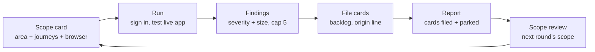

> **Purpose:** EXPLAIN — how the signed-in QA round works: weekly on
> Fridays, and on demand when a sprint with the loop on finishes its
> build.
> **Earns its place if:** every round leaves a report and filed cards, and the founder can question the scope.
> **Owner:** Bramble. **Status:** living.
> **Last verified:** 2026-11-23, against the founder's approval of the
> sprint-phase design ("Approve all — build it").

# QA loop — design

## The problem

The Closet ships fast. The founder tests each card on his phone. No one tests the live app end to end, signed in, on a schedule. Bugs and rough edges surface only when he trips over them. Ad-hoc testing does not scale. A round without a scope finds everything and files nothing. A round without a limit floods the backlog.

## The loop

Rounds run weekly on Friday, and on demand when a sprint with the QA
loop on finishes its build. Each round has five steps.

1. **Scope.** The round starts with a written scope card. It names the area, the journeys, and the browser. No scope, no round.
2. **Run.** Bramble signs in and tests the live app in the browser. The pass covers the scope area in depth. It also smoke-tests the core journeys.
3. **Findings.** Each finding gets a severity and a size. Findings above the bar become backlog cards. The rest go to a parked list in the round report.
4. **Report.** The round leaves a report. It lists the date, the scope, what was tested, the cards filed, the parked items, and the next round's scope.
5. **Scope review.** The report sets the next round's scope. The scope changes each round. It follows what the last round found and missed.

## Sprint-triggered rounds (2026-11-23, founder-approved)

A sprint with the QA loop on does not close at deploy. It closes after
its own QA round, fix pass, and retest.

- **Trigger:** the sprint's build is deployed. The round runs on demand,
  not on Friday.
- **Scope:** the sprint's cards, signed in, on the live site.
- **Replacement:** a sprint-triggered round replaces the nearest Friday
  round. No week gets two rounds. The Friday run stands down that week.
- **Sign-in fallback:** if the founder's approval does not arrive, the
  sprint stays open. The round retries at the next Friday. The founder
  can override with "ship without QA". The system never skips QA on its
  own.
- **Fix pass:** one pass covers the filed P1 cards (cap 5). The retest
  confirms them. New P1s from the retest get filed; the sprint closes
  only when the founder accepts them as known issues or calls a second
  fix pass.
- **Phone test:** the founder's phone test follows the retest. The QA
  round never replaces his phone test.
- **Origin line:** sprint-round cards carry "Origin: QA round, <date>
  (Sprint <n>), scope <area>." Friday-round cards keep "Origin: Weekly
  QA round, <date>, scope <area>."

## Scope

The scope is well defined before each round. It changes after each round.

- **Round 1 (2026-11-23):** the six Sprint 32 cards, signed in, on the
  live site. Filed four P1 cards (PC-82..85).
- **Round 2 (2026-11-23):** the Sprint 33 retest, on demand. Three
  fixes verified (PC-82, PC-83, PC-85); three failed. Filed three new
  cards (PC-86..88); PC-84 carries the retest fail in its status.
- **Sprint-triggered rounds** take the sprint's cards as scope.
- **Later rounds** rotate one area in depth: capture, Today, chat, trips, settings, or the latest sprint's cards. The core journeys get a smoke pass every round.
- **Web apps only, for now. The Closet is first (QA loop on since
  2026-11-23).** Other products join only when the founder asks — the
  system asks whether the QA loop should be added when a product joins
  the studio, and the answer is recorded in the product's PRODUCT.md.
- The scope card names four things: the area, the journeys, the browser and device, and what is out of scope.

Core journeys (smoke pass, every round):

- Capture a photo → the item appears in the catalogue.
- Ask the stylist for a pick → a card comes back.
- Log a pick as worn → the wear shows.
- Open Today → the pick and the weather show.
- Open a trip → the trip context holds.

## Discovery limit

The cap is 5 cards per round. This cap is hard.

- **Severity:** P0 blocks a core journey. P1 hits a real user often. P2 is a rough edge.
- Only P0 and P1 become cards. P2 items go to the parked list. The parked list is reviewed when its area comes up again.
- If a round finds more than 5 card-worthy items, the top 5 by severity become cards. The rest go to the parked list with their severity noted.
- A cap keeps the backlog usable. It also forces ranking. A flood of cards is the same as no cards.

## Backlog structure

Each finding becomes a paper-cut card in the Closet BACKLOG.md. The card uses the standard format: Problem, In scope, Out of scope, Done looks like, Effort.

- Each QA card carries one origin line: "Origin: Weekly QA round, <date>, scope <area>." The source stays traceable.
- Cards are filed in the same pass as the round. No separate filing step exists. A finding without a card is not a finding.
- The round report lists every card filed, with its number, and every parked item.
- QA cards join the normal queue. They wait for a planning walk like any other card. The walk decides what ships.

## Login and browser

The round needs his real account. Only his account holds his real wardrobe.

- **Route (proposed):** the cloud browser signs in with his Google account. The password route fails the human check in the cloud browser. Google sign-in plus his phone approval works. Splitwise proved this today.
- **Fallback:** his live Chrome through the extension. This needs his notice before each use. The extension stays off by default.
- The round uses the app as a user would. It creates test data only through the flows it tests. It removes test data at the end of the round, or labels it clearly. It never deletes his items. It never sends messages.

## Schedule

- **Weekly on Friday, ~9:14 AM PT.** This matches the other morning jobs.
- **Plus on-demand sprint rounds** (see above), which replace the nearest
  Friday round.
- The round report goes to the product chat. The findings are product cards. The system record lives in this studio file.
- The Friday cron runs weekly; sprint rounds run on demand.

## Evidence and health

- Each round leaves two artifacts: the round report and the cards it filed. No report means no round.
- Round reports are filed at `workspace/goals/one-man-studio-operating-system/hidden_files/qa-rounds/YYYY-MM-DD.md`. The report's first line carries the round status: completed or skipped.
- The loop becomes a studio capability. It gets a register row in CAPABILITIES.md. It gets a diagram in the Process Health Diagram Space. A health check counts rounds run against rounds due; a sprint-triggered round in a week covers that week's Friday. These ship with the build, not with this design.
- The scope review is the control step. If two rounds in a row file zero cards, the scope is too narrow or the area is healthy. The scope then widens or moves on.

## Decisions (settled)

Design decisions, 2026-11-23 (founder: "Approve the design — build it"):

1. Login route: cloud browser, Google sign-in + his phone approval.
2. Schedule: Friday 9:14 AM PT.
3. Discovery cap: 5 cards per round.
4. Round 1 scope: the six Sprint 32 cards.

Sprint-phase decisions, 2026-11-23 (founder: "Approve all — build it"):

1. The QA + fix phase sits after deploy, before the founder's phone test.
2. "Optional" attaches per product, at onboarding. The Closet is on.
3. A sprint round replaces the nearest Friday round. No week gets two rounds.
4. If the sign-in approval does not arrive, the sprint stays open. The founder can override with "ship without QA".
5. One fix pass covers the filed P1 cards (cap 5). The sprint closes only when the founder accepts new P1s as known issues or calls a second fix pass.
