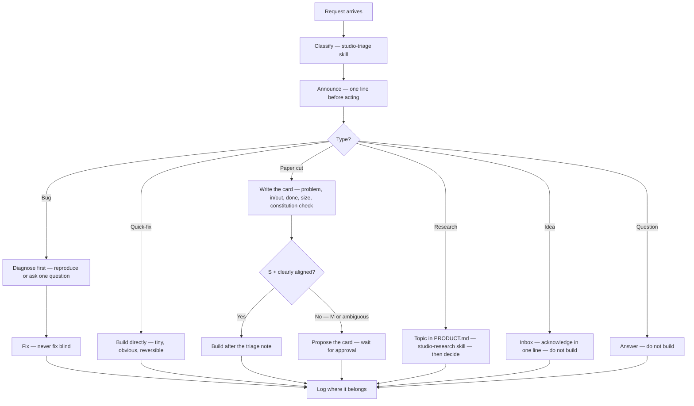
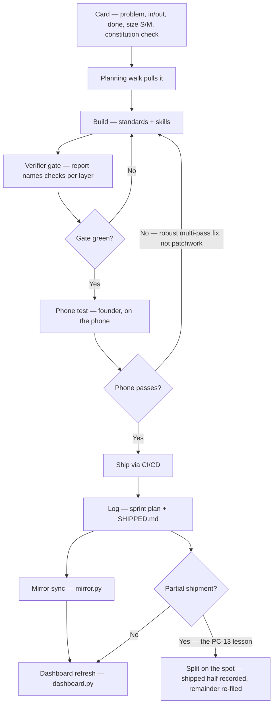
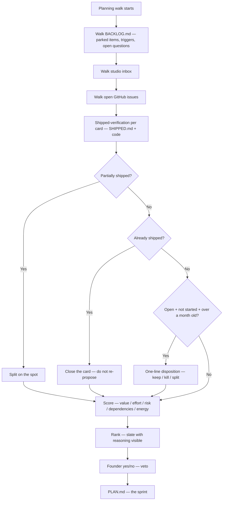
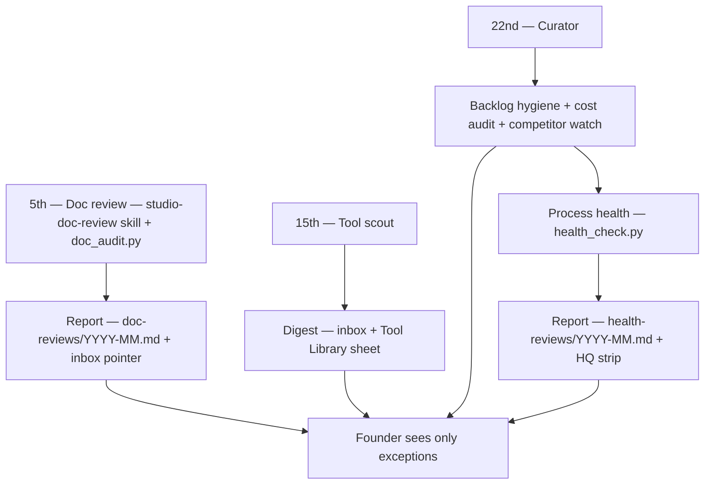
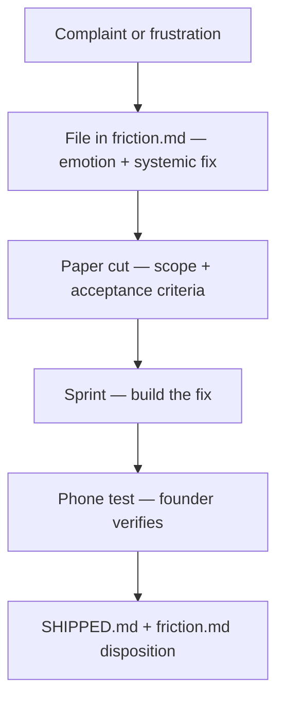
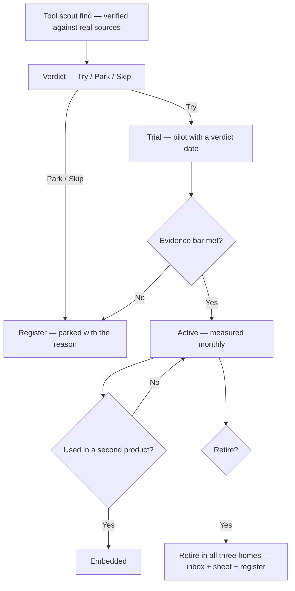

# Studio workflows — one flowchart per process

> **Purpose:** EXPLAIN — how a request becomes a shipped cut, how a sprint gets planned, what the monthly machinery does, and where each step leaves its proof.
> **Earns its place if:** the founder can inspect any workflow on one page, see which step has no proof, and say what should change.
> **Owner:** Bramble. **Status:** living.
> **Last verified:** 2026-11-15, against PLAYBOOK.md and the `studio-triage` skill.

Published copy: https://github.com/nachiketmparanjape/one-man-studio/blob/main/WORKFLOWS.md — kept diff-zero with this file; the Mermaid diagrams render natively on GitHub.

Diagram currency: if this file changes a number, status, or structure shown on the Process Health Diagram Space, send the Space edit in the same pass (PLAYBOOK.md: diagram currency).

## What this is, in plain words

The PLAYBOOK's rule: anything we do more than twice, or anything where
ad-hoc execution risks quality, gets a defined workflow — named steps, in
order, each with its log destination. No workflow, no reliability; no
reliability, no trust. This doc is the visual map of those workflows. The
Orchestration and Design Catalog holds the diagrams for scheduled jobs and
key designs; this doc holds the diagrams for the work itself. Each diagram
shows the real branches — the decisions, not just the happy path — and the
machinery that does each step (skill, script, or file), so you can see what
a step runs on and where its proof lives.

## 1. Request triage — the PM gate

Purpose: every request gets classified, announced, routed, and logged before
anything is built. "Quick" describes the build, never the thinking.

Proof lives in: the triage line in chat; the outcome in the sprint plan,
`SHIPPED.md`, `friction.md`, inbox, or `PRODUCT.md` — never chat-only.
Every log entry carries a `**Status:**` line at write time (LOGS.md) —
status, owner, priority, next action or revisit trigger — so the entry
is not logged until it is tagged. When torn between two types, pick the
heavier one.

## 2. Paper-cut lifecycle — the sprint loop

Purpose: one small shippable improvement at a time, from card to phone test
to the record. Anything bigger gets split, no exceptions.

Proof lives in: the card, the gate report, the SHIPPED.md entry naming the
phone test, the mirror issue, the dashboard. A cut with no card never ships;
a ship with no phone test is not verified.

## 3. Sprint planning walk — the hard rule

Purpose: the full inventory is walked before any slate decision. Skipping
the walk is a process violation, even when the "obvious" sprint is obvious.

Proof lives in: `PLAN.md` (the walk record, the dispositions, the ranked
slate with reasoning). The walk is what catches the stale entry, the fired
trigger, and the forgotten idea. The monthly curator repeats the
shipped-verification and the aging check as backlog hygiene.

## 4. Monthly machinery — the quiet passes

Purpose: recurring passes that keep the studio healthy without the founder
having to remember them. Each reports through the inbox; the founder is
interrupted only on signal.

Proof lives in: the dated reports and the inbox entries. The doc review's
reaper proposes retirement verdicts — never silently applied. The health
check's two-month rule files a corrective paper cut — never just a number.

## 5. Friction → fix — complaints become paper cuts

Purpose: a frustration is filed with its emotion and its systemic fix, not
as a transcription of the words — then it becomes a card and gets built.

Proof lives in: the friction entry with its disposition. Examples: the
jittery-sheets complaint became UX-15 (an audit of all overlays, not a
one-line fix); the Nov 1 code-quality verdict became a multi-pass fix with
a from-scratch review. A friction entry with no disposition is a process
failure — the health check measures exactly that (H7).

## 6. Capability intake — new tools enter through a trial

Purpose: a new tool or skill enters as a trial with a verdict date, and
graduates — or dies — on evidence, in all three homes at once.

Proof lives in: the inbox pilot entry, the Tool Library sheet row, and
`CAPABILITIES.md`. The three-homes rule is the debt-ops lesson: a tool
killed in the inbox but still reading "Try" in the sheet a month later is
the failure this exists to prevent.

## How to use this to improve a workflow

Three questions, one diagram at a time:

1. **Which step has no proof?** A step whose box names no file, skill, or
   script is a hope, not a step. Either it leaves proof somewhere (name
   it) or it does not happen reliably (fix it or cut it).
2. **Which branch is never taken?** A decision diamond whose "no" path has
   no record is either a dead branch (cut it) or a path nobody admits to
   (the check should be catching it).
3. **Which step gets skipped most?** The health check's failing items name
   the steps. A step that fails twice running is not a discipline problem
   — it is a workflow that costs more than it is worth, and the fix is to
   redesign the step, not to scold the person skipping it.
